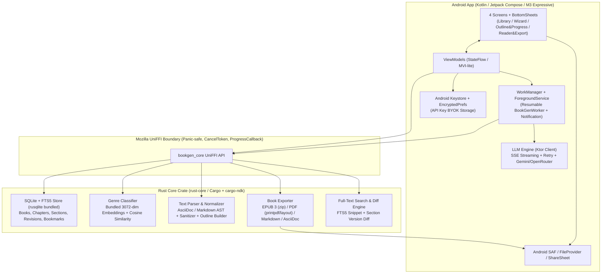
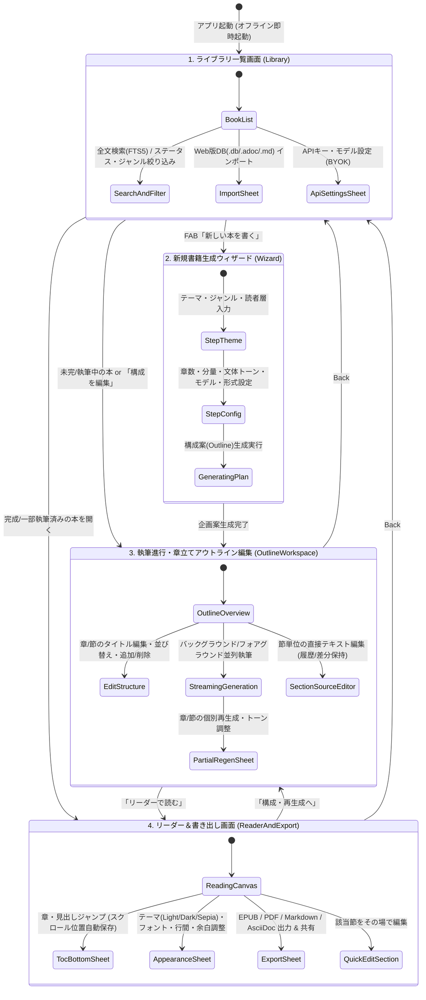

# BookGen (Co-Author Studio) Android 移植・刷新仕様書 (`spec.md`)

- **対象システム**: `bookgen` (Co-Author Studio Web版) → `bookgen-android` (Android Native + Rust Core)
- **作成日**: 2026-11-24
- **ステータス**: Phase 1 Draft（承認待ち）

---

## 1. 既存 Web 版 (`bookgen/`) の徹底解析

### 1.1 ファイル構成と役割

| ファイル | 行数/サイズ | 役割 |
|---|---|---|
| `index.html` | 2,486行 | 単一HTMLファイルのSPA（CSS + UI + Vanilla JS）。Asciidoctor.js / KaTeX / Google Fonts をCDN経由で読み込み、認証・ライブラリ・構成閲覧・リーダー・分割エディタ・生成進捗ドックを実装。 |
| `api.php` | 649行 | PHP APIバックエンド。セッション認証（`users` テーブル）、IP別レート制限（`rate_limits`）、SQLite WAL管理（`books`, `chapter_sections`）、Gemini / OpenRouter 統一LLM呼び出し、Embeddingベースのジャンル自動分類。 |
| `genres.php` | 135行 | 12ジャンルのメタデータ定義（`name`, `seed_text`, `editor_guide`, `element_label`, `author_style`）。 |
| `config.php` / `config_example.php` | 25行 | `GEMINI_API_KEY`, `OPENROUTER_API_KEY`, `INVITE_CODE`, `DAILY_LIMIT_PER_IP` (20)、モデル設定（`gemini-embedding-2`, `inclusionai/ling-3.0-flash`, OpenRouter `novita` プロバイダ固定）。 |
| `.htaccess` | 11行 | `config.php`, `*.json`, `*.md` への直アクセス禁止、`max_execution_time=180`, `memory_limit=256M`。 |
| `books/app_data.db` | ~3.0 MB | SQLiteデータベース（`users` 2件, `books` 7件, `chapter_sections` 171行, `rate_limits` 3件, 旧 `chapters` テーブル 70行）。 |
| `books/genre_embeddings.json` | ~2.3 MB | 12ジャンルそれぞれの3072次元 Embedding ベクトルキャッシュ。 |
| `books/<id>/` | 8ディレクトリ | 旧世代（`1790567793`〜`1790569421`: `.md`形式）および過渡期（`1790573377`〜`1790583392`: `.adoc`形式）のディレクトリベース保存データ。 |

### 1.2 現在の画面・モーダル一覧

`index.html` は単一ページ上に状態切替で以下のビュー・モーダルを構成している：

1. **認証モーダル (`#authModalBackdrop`)**: ログイン / 新規アカウント登録（`invite_code` 必須）の切り替え。
2. **左サイドバー / ドロワー (`#left-pane`)**:
   - 「＋ 新規作成」ボタン
   - タブ切替：`ライブラリ`（作成済み書籍一覧） / `構成`（選択中書籍の「概要」＋章リスト）
   - 検索バー（タイトル・ジャンル名・章タイトル/focus_area/節タイトルのクライアント側部分一致フィルタ）
3. **空状態（ワークスペースホーム / `.empty-state-view`)**: クイックアクションカード 2枚（新規作成 / ライブラリ参照）とキーボードショートカット一覧。
4. **ドキュメント概要ビュー (`showOverview()`)**: ジャンルバッジ、作成日、タイトル、想定読者、コンセプト・概要、章・節の目次カード一覧、「Next → 第1章」ナビゲーション。
5. **章リーダービュー (`showChapter(chNum)`)**: 章番号・文字数・読了目安時間（`Math.round(charCount / 600)`分）バッジ、Asciidoctor.js + KaTeX によるHTMLレンダリング、コードブロックのCopyボタン、テーブル横スクロールラッパー、前後の章ナビ、右サイドバーTOC（`#right-pane`、幅1024px以下ではモバイルボトムシート `#mobileTocSheet`）。
6. **章エディタビュー (`#editorView`)**: 上部ツールバー（保存状態バッジ、文字数、`ソース / スプリット / プレビュー` 切替、保存/キャンセル）、フォーマット補助バー（`H2`, `H3`, `**B**`, `` `code` ``, `$$LaTeX$$`, `Block`, `NOTE`, `Table`）、デバウンス160msライブプレビュー。
7. **新規作成モーダル (`#modalBackdrop`)**: テーマ入力テキストエリア1つのみ。
8. **進捗ドック (`#pipelineDock`)**: 左下固定のフローティング黒枠ドック（進捗率%、プログレスバー、タイムスタンプ付きログ）。
9. **確認モーダル群**: 削除確認 (`#deleteModalBackdrop`)、編集破棄確認 (`#discardModalBackdrop`)、ログアウト確認 (`#logoutModalBackdrop`)。
10. **モバイル下部ナビゲーションバー (`#mobileBottomBar`)**: 幅768px以下で表示（構成・一覧 / 見出し / 編集 / 保存）。

### 1.3 現在のユーザーフローと AI API 通信仕様

```
[ログイン / 招待コード登録]
  └─▶ GET api.php?action=check_auth
  └─▶ GET api.php?action=list_books
        │
        ├─▶ [既存書籍選択] GET api.php?action=get_book&book_id=...
        │      ├─▶ 概要閲覧 (showOverview)
        │      ├─▶ 章閲覧 (showChapter -> Asciidoctor.js + KaTeX)
        │      ├─▶ 章編集 (toggleEditor -> POST update_chapter)
        │      ├─▶ 書き出し (exportCurrentBook -> .adoc Blob ダウンロード)
        │      └─▶ 削除 (POST delete_book)
        │
        └─▶ [新規作成] テーマ入力 -> runGenerationPipeline()
               ├─▶ Step 1: POST api.php {action: "plan", theme}
               │      ├─ IP日次レート制限カウント (+1)
               │      ├─ Gemini Embedding API (gemini-embedding-2) でジャンル12種とコサイン類似度判定
               │      ├─ PLANNER LLM へ JSON企画案生成リクエスト (全6〜8章, 各章3〜4節)
               │      └─ books テーブルへ INSERT (id = random_bytes(8) hex)
               └─▶ Step 2: ブラウザ側ループ (章ごとに直列、章内の節は Promise.all で並列)
                      └─ POST api.php {action: "write_section", book_id, ...}
                           ├─ WRITER LLM へ AsciiDoc 本文生成リクエスト
                           └─ chapter_sections テーブルへ UPSERT
```

**AI API 通信仕様 (`api.php`):**
- **Embedding API**: `POST https://generativelanguage.googleapis.com/v1beta/models/{MODEL_EMBEDDING}:embedContent?key=...`
  - ペイロード: `{"model": "models/gemini-embedding-2", "content": {"parts": [{"text": "task: classification | query: <text>"}]}}`
  - 3072次元ベクトルを取得し、`books/genre_embeddings.json` とコサイン類似度で最良ジャンルを決定（失敗時は `'tech'` フォールバック）。
- **Gemini Generate API**: `POST https://generativelanguage.googleapis.com/v1beta/models/{model}:generateContent?key=...`
  - `system_instruction`, `contents`, `generationConfig.temperature`, さらに `$jsonSchema !== null` の場合は `response_mime_type: "application/json"` と大文字型変換済み `response_schema` を付与。
- **OpenRouter Chat Completions API**: `POST https://openrouter.ai/api/v1/chat/completions`
  - モデル名に `/` を含む場合、または Gemini キーが空の場合に選択。
  - `provider: { only: OPENROUTER_PROVIDERS, allow_fallbacks: false }`（デフォルト `["novita"]`）。
  - Novita 等で `response_format` が 400 エラーになる問題を避けるため、`response_format` は送らずプロンプトのみで JSON 出力を強制し、最初の `{` から最後の `}` までを切り出して `json_decode` する。

### 1.4 データ保存方式（現状の変遷と実態）

`bookgen/books/` の実データ調査により、Web版は3段階のデータ形式変遷を経ていることが判明した：
1. **第1世代（ディレクトリ + `.md`）**: `1790567793`〜`1790569421`。`book.json` 内の章に `author_name`, `author_persona`, `key_topics` 等があり、本文は `chapter_N.md`（Markdown）。
2. **第2世代（ディレクトリ + `.adoc` + `chapters` テーブル）**: `1790573377`〜`1790583392`。`focus_area`, `sections` 構造へ移行し、本文は `chapter_N.adoc`（AsciiDoc）。`app_data.db` 内の旧 `chapters` テーブルにも 10冊分・70行が残存。
3. **現行世代（SQLite `books` + `chapter_sections`）**: `api.php` が参照する現行スキーマ。ただし `books` テーブルの7冊分のうち一部は `chapter_sections` に欠損・異常レコードが存在する。

---

## 2. 既存 Web 版の課題・弱点・ボトルネック（実測・コード検証に基づく抽出）

実コード（`api.php`, `index.html`, `genres.php`）および `app_data.db` の検証から、以下の具体的な問題点を特定した。

### 2.1 生成パイプラインの脆弱性と途中失敗による欠損（最重要）
- **ブラウザ依存の直列・並列オーケストレーション**: `index.html` の `runGenerationPipeline()` がクライアントJS側で章ループ＋節 `Promise.all()` を回しているため、モバイルブラウザで画面を閉じる・スリープする・ネットワークが瞬断すると生成が中断される。
- **リトライ・途中再開（レジューム）の不在**: 1節でも HTTP 500 / タイムアウトになると `Promise.all` 全体が reject し、途中の状態で放置される。`app_data.db` の実データでも **7冊中4冊で予定節数に対する欠損** が発生していた：
  - `f4080426b00c8c32`: 予定28節 → 保存25節（3節欠損）
  - `20cc3d00be55102e`: 予定32節 → 保存29節（3節欠損）
  - `5d2ec412c2506f3b`: 予定28節 → 保存22節（6節欠損）
  - `b904defea506a36f`: 予定28節 → 保存25節（3節欠損）
- **空レスポンスの無検証保存バグ**: `callOpenRouter()` は `choices[0].message.content` が空でも空文字 `""` を返し、`write_section` は空チェックなしで `chapter_sections` に `INSERT` する。実際に `app_data.db` で `length(content) == 0` の空節が3件確認された（`3a0ee74c8ae31334` ch7 sec71, `20cc3d00be55102e` ch3 sec4, `3aab499528c77238` ch6 sec1）。
- **API タイムアウト / レート制限 (429/503) への無対策**: `curl_exec` の1回失敗で即 `Exception` となり、指数バックオフ・リトライやプロバイダフォールバックがない。またストリーミング非対応のため最大180秒の無応答待機が発生する。

### 2.2 生成品質・プロンプト設計上の欠陥
- **`genres.php` の詳細ガイドが未使用**: `genres.php` には `editor_guide`, `element_label`, `author_style` が定義されているにもかかわらず、`api.php` は `plan` で `name` しか使わず、`write_section` では `$genres` すら参照していない。
- **コンテキスト分断（前後の章・節の文脈欠如）**: `write_section` には書籍全体 `overview` や前節までの流れが渡されず、単一の節タイトルと `key_focus` のみで執筆するため、章・節間の重複やトーンのブレが生じる。
- **記法混在と正規表現による誤破壊**: `callUnifiedLLM()`（`api.php:300`）は JSON 用の ```` ``` ```` 除去処理を本文生成にも無条件適用しているため、コードブロックで始まる・終わる節のバッククォートが破壊される恐れがある。また DB 実データ上でも AsciiDoc 指定時に `== 第3節 ...` のような重複見出しや番号ズレ（`section_number: 71..74`）が発生している。
- **生成オプションの貧弱さ**: テーマ1行しか指定できず、章数・分量・文体トーン・言語・出力形式（Markdown / AsciiDoc）・使用モデルを選択できない。また生成された目次アウトラインを執筆前に確認・編集・並べ替えする工程がない。

### 2.3 データ整合性・セキュリティ・パフォーマンスのボトルネック
- **節粒度の破壊 (`update_chapter` の仕様バグ)**: 閲覧時 (`get_book`) は `chapter_sections` を連結し、編集保存時 (`update_chapter`) はその章の全 `chapter_sections` を `DELETE` して `section_number = 1` の1行へ潰してしまう（`api.php:447-454`）。編集後は節単位の部分再生成や細粒度管理が不可能になる。
- **ユーザー間のデータ分離欠如**: `books` テーブルに `user_id` がなく、認証済みユーザー全員が全書籍を閲覧・編集・削除可能。
- **XSS 脆弱性**: `index.html` の `renderLibraryList()`, `showOverview()`, `showChapter()` が書籍タイトルや概要をエスケープせず `innerHTML` に直接展開している。
- **全章一括ロードとオフライン不可**: `get_book` が全章の本文を1回のJSONレスポンスで丸ごと取得する（最大 ~290KB 超）。また `Asciidoctor.js` / `KaTeX` / `Google Fonts` を CDN に依存しているためオフラインで一切閲覧できない。
- **検索・書き出し機能の不足**: 全文検索ができず（メタデータ部分一致のみ）、書き出しは `.adoc` 生ファイルダウンロードのみ（EPUB / PDF / Markdown 非対応）。リーダーに文字サイズ・行間・ダーク/セピア切替・読書位置記憶もない。

---

## 3. 移植後のアーキテクチャ設計（Kotlin + Rust / UniFFI）

### 3.1 基本方針
Web版の「PHPサーバー中央集権型」から、**「ローカルファースト・スタンドアロン完結型（オフライン読書/検索/ビルド完全対応）」** へ刷新する。書籍データ・全文検索インデックス・フォーマット変換・状態管理はすべて **Rust (`rust-core`)** に集約し、**Mozilla UniFFI** 経由で Kotlin へ安全な型付きバインディングを公開する。UI・Android OS連携（WorkManager, Foreground Service, EncryptedSharedPreferences / Keystore, ShareSheet / SAF）を **Kotlin (Jetpack Compose / Material 3 Expressive / MVVM + Clean Architecture)** が担当する。

### 3.2 全体アーキテクチャ図（Mermaid）



### 3.3 Kotlin 側と Rust 側の責務分担

| レイヤー / 機能 | 担当 | 具体的な責務と技術選定 |
|---|---|---|
| **UI / デザインシステム** | Kotlin (Compose) | Material 3 Expressive（Light / Dark / Sepia / Dynamic Color）、Edge-to-Edge、Navigation 3、スプリングモーション、`WindowSizeClass` 対応レスポンシブレイアウト。 |
| **状態管理 / DI** | Kotlin (MVVM) | `ViewModel` + `StateFlow` / `SharedFlow`（単発イベント）、Hilt（または手動AppContainer DI）、Clean Architecture（`ui` / `domain` / `data`）。 |
| **AI API 通信・並列制御** | Kotlin (Coroutines + Ktor) | Gemini (`generateContent` / `streamGenerateContent` / `embedContent`) および OpenRouter (`chat/completions` SSE) 通信。指数バックオフリトライ、レート制限ハンドリング、キャンセル制御。 |
| **バックグラウンド執筆** | Kotlin (WorkManager) | `CoroutineWorker` + Foreground Notification（進捗バー・一時停止/再開・完了通知）。アプリ終了後も節単位で中断位置から自動再開。 |
| **セキュリティ / 鍵管理** | Kotlin | Android Keystore バックアップの `EncryptedSharedPreferences` で API キーを暗号化保存。 |
| **書籍DB・永続化・検索** | **Rust (`rusqlite` + FTS5)** | WALモードSQLite管理、`books / chapters / sections / section_revisions / reading_progress` の原子的トランザクション、FTS5による日本語N-gram/ユニコード全文検索、既存 `app_data.db` / `.adoc` / `.md` インポート。 |
| **テキスト解析・構造化** | **Rust (`pulldown-cmark` 等)** | AsciiDoc / Markdown の構造化AST解析（リーダー用の高速ネイティブブロック変換・見出し抽出・コードブロック・数式・テーブル・Admonition）、LLM出力のサニタイズ・フェンス誤除去防止・節番号正規化・文字数/読了時間算出。 |
| **ジャンル分類ベクトル演算** | **Rust** | `genre_embeddings.json` 由来の12ジャンルベクトルと入力テキストEmbeddingの高速コサイン類似度計算・ランキング。 |
| **書籍フォーマット変換** | **Rust** | **EPUB 3**（XHTML変換・OPF・NCX/Nav・CSS・ZIPパッケージング）、**PDF**（日本語フォント埋め込み対応組版またはWebView/PrintDocumentAdapter連携のハイブリッドも検討→Phase 3でRust純正PDF生成＋プレビュー確定）、**統合Markdown**、**AsciiDoc** エクスポート。進捗コールバック＋キャンセル対応。 |
| **FFI 安全性** | **Rust + UniFFI** | `catch_unwind` ラッパー、明示的 `BookGenError` enum、`CancellationToken`、`ExportProgressListener` コールバックインターフェース。 |

### 3.4 画面遷移図（Mermaid）



---

## 4. 改善提案セクション（Web版からのアップグレード計画）

### 4.1 UX・モバイル最適化
1. **バックグラウンド生成と完了・エラー通知 (`WorkManager` + Foreground Service)**
   - アプリを閉じたり画面をオフにしても執筆パイプラインが継続し、通知バーに「第3章 2/4節 執筆中 (45%)」を進捗表示。完了時・エラー中断時はタップで該当書籍のアウトライン画面へディープリンク遷移する。
2. **執筆の途中再開（レジューム機能）と不完全状態の自動検知**
   - すべての節に `status`（`pending`, `generating`, `completed`, `failed`, `empty`）を持たせ、アプリ再起動時や `app_data.db` インポート時に「未執筆・空文字・失敗の節」だけを自動抽出して **「残りのN節を再開」** ボタンを提示する。
3. **章立て編集＆章・節ごとの部分再生成・トーン調整**
   - 企画案（Plan）作成後、いきなり本文生成に突入せず、アウトライン画面で章・節の並び替え・タイトル修正・`key_focus` 追記を行ってから執筆開始できる。
   - 執筆後も「この章を初心者向けに噛み砕く」「具体例・コードを増やす」「より簡潔に」等のトーン指示付きで**章単位または節単位の部分再生成**を可能にし、生成前後のバージョン差分を保持する。
4. **快適なモバイルネイティブリーダー**
   - **テーマ3種＋Dynamic Color**: Light（Editorial Ink）/ Dark（Tonal Slate）/ **Sepia（Warm Paper `#F4ECD8`）** をワンタップ切替。
   - **タイポグラフィ制御**: フォント種別（サンセリフ / 明朝系セリフ）、文字サイズ（`14sp`〜`24sp`）、行間倍率（`1.4x`〜`2.0x`）、水平余白のカスタマイズ。
   - **読書位置の自動保存＆「続きから読む」ヒーローカード**: ライブラリ画面最上部に直近開いた書籍・章・スクロール位置へのクイックレジュームカードを配置。
   - **ネイティブコードブロック・数式・テーブル表示**: WebView頼みではなく Compose ネイティブブロック描画＋水平スクロールテーブル＋ワンタップコピー＋数式表示。

### 4.2 Rust による高速化・堅牢化
1. **ローカルファースト永続化と `section_number` 粒度の保護**
   - 編集時に節を潰していたWeb版の設計バグを修正し、編集・再生成・表示のすべてで `(book_id, chapter_id, section_id)` のUUID/安定IDを維持。編集履歴（`section_revisions`）を自動保存。
2. **SQLite FTS5 による高速横断全文検索**
   - ライブラリ全体のタイトル・概要・全章本文を対象としたミリ秒オーダーの全文検索とヒット箇所スニペット抽出をRustで提供。
3. **高速なマルチフォーマット書籍ビルド（EPUB 3 / PDF / Markdown / AsciiDoc）**
   - Rust 側で書籍ASTを組み立て、**EPUB 3**（ZIP圧縮、目次XHTML、スタイルシート同梱）、**PDF**（ページ分割・目次・見出し・コードブロック整形）、**統合Markdown**、**AsciiDoc** を数百ミリ秒〜数秒でオフライン生成。大規模書籍でもUIスレッドをブロックせず、`ExportProgressListener` で進捗通知＆キャンセル可能。
4. **出力正規化・差分管理・既存データ移行**
   - LLM出力のMarkdown/AsciiDoc混在自動補正（冒頭/末尾コードブロックの誤削除を防ぐ文脈認識トリム）、重複章見出しの正規化、文字数・読了時間のRust高速集計。
   - 既存の `bookgen/books/app_data.db` や `.adoc` / `.md` フォルダをAndroidアプリにインポートできる互換ローダーをRust側に実装。

### 4.3 生成品質・安定性・セキュリティ
1. **`genres.php` の完全活用と文脈引き継ぎプロンプト**
   - `genres.php` の `editor_guide`, `element_label`, `author_style` を企画立案 (`plan`) と執筆 (`write_section`) の両方に組み込む。
   - 各節の生成プロンプトに「書籍全体の概要」「前節の要約（または末尾抜粋）」「次節の予定トピック」を注入し、章間の重複や唐突な導入を防止。
2. **自動リトライ・レート制限制御・構造化エラー処理**
   - HTTP 429 / 502 / 503 / タイムアウトに対し、ジッター付き指数バックオフリトライ（最大3回）＋ `Retry-After` ヘッダ尊重。
   - 空レスポンスやJSONパース失敗時はDB保存前に弾き、JSON修復または再リクエストを自動実行。
3. **並列度制御（セマフォ）とリアルタイムストリーミング**
   - ブラウザ版のように1章全節を無制限同時発火せず、ユーザー設定可能な同時実行数（デフォルト2並列）でSSEストリーミング受信し、リアルタイムにDBへ部分保存・UI表示する。
4. **BYOK（ユーザー自身のAPIキー管理）と安全な認証設計**
   - Web版サーバーの `config.php` + PHPセッション依存から脱却し、Android Keystore 暗号化領域に Gemini / OpenRouter API キーを保存。ジャンル自動分類もローカル同梱の `genre_embeddings.json` をRustで演算するため、Gemini Embedding 1回（またはオフライン簡易キーワードマッチへのフォールバック）のみで即座に分類できる。

---

## 5. Penpot / Material 3 デザインシステム＆4画面仕様

> **Penpot 実ファイル情報**: Penpot 2.18.7 上のファイル `新しいファイル 1` (`fileId: 29883df9-fd36-8190-8008-feabca1cbdab`, ページ `BookGen Android UI` / `pageId: 29883df9-fd36-8190-8008-feabca1cfe0a`) にトークン 5 セットおよび以下 4 画面を構築・目視検証済み。エクスポート仕様は [design/tokens.json](design/tokens.json) および [design/penpot-mcp-blueprint.md](design/penpot-mcp-blueprint.md) に同期保存（経緯: [GAP-001](devlog/gap/001-penpot-mcp-not-connected.md)）。

| 画面 | Penpot Board ID | 概要 |
|---|---|---|
| `01-Library` | `6c914749-5949-80d9-8008-feb23efd4289` | ホーム / ライブラリ一覧（FTS5検索・再開ヒーロー・4冊表示・16dp FAB） |
| `02-Wizard` | `6c914749-5949-80d9-8008-feb2ae03a82c` | 新規書籍生成ウィザード（テーマ・ジャンル判定・テンプレート・分量/トーン/形式） |
| `03-OutlineWorkspace` | `6c914749-5949-80d9-8008-feb46176853b` | 執筆進行・章立て編集（WorkManager進捗・LIVE SSE・節ステータス・部分再生成） |
| `04-ReaderAndExport` | `6c914749-5949-80d9-8008-feb72c0a4bc7` | リーダー＆書き出し（明朝体/コード/NOTE・Light/Sepia/Dark切替・EPUB/PDF/MD/ADOC出力） |

### 5.1 デザイン方針（`mobile-design-android` + `penpot-anti-slop` 準拠）
- **スタイルプロファイル**: **Editorial × Functional**（書斎の知的な落ち着きと、編集ツールとしての明快な情報階層を両立）。
- **Anti-Slop 回避指針**:
  - 紫/ネオン系の汎用AIグラデーション（`violet-gradient`）、キラキラ絵文字（`sparkle-ai-marker`）、中央寄せカード量産（`centered-hero-stack`, `identical-triplet`）、すりガラス（`frosted-glass`）、純白 `#FFFFFF`/純黒 `#000000` を排除。
  - **Editorial Ink & Warm Stone** を軸とし、主アクセント（Deep Indigo-Ink `#1E3A5F`）は主要CTAに集中、副アクセント（Terracotta `#9A4A2E`）はしおり・再生成マーカーに限定。
  - M3 Expressive の **48色ロール構造**、**丸角四角形FAB (`16dp`)**、**強調タイポグラフィ (`*Emphasized`)**、**スプリング物理アニメーション (`MaterialTheme.motionScheme`)** を採用。

### 5.2 カラートークン（Light / Dark / Sepia + Dynamic Color Fallback）

`design/tokens.json` に W3C DTCG / Penpot `tokens-schema.json` 形式で全トークンを定義済み。主要セマンティックロール：

| Semantic Token | `modes/light` | `modes/dark` | `modes/sepia` (Reader専用) | 用途 |
|---|---|---|---|---|
| `color.bg.default` | `#FAF8F5` | `#131417` | `#F4ECD8` | 画面ルート背景 |
| `color.bg.surface` | `#FFFFFF` (Elev0) / `#F3F0EA` (Low) | `#1B1D22` (Low) / `#22252B` (Container) | `#EFE5CE` | カード・シート・パネル |
| `color.bg.surfaceHigh` | `#EAE5DC` | `#2B2E36` | `#E4D7BA` | チップ・検索バー・入力面 |
| `color.text.default` | `#1A1917` | `#ECE9E2` | `#3B2F23` | 本文・見出し |
| `color.text.muted` | `#5E5A54` | `#B4AFA6` | `#6E604F` | メタ情報・副文 |
| `color.action.primary.bg` | `#1E3A5F` | `#9EC2F0` | `#6F4423` | 主要CTA・アクティブ指標 |
| `color.action.primary.text` | `#FAF8F5` | `#0E2340` | `#FAF4E6` | Primary上のテキスト |
| `color.accent.secondary` | `#9A4A2E` | `#E8A389` | `#8F4B2C` | しおり・更新マーカー・FAB補助 |
| `color.accent.tertiary` | `#2C6B6E` | `#7FC8CB` | `#3D6B68` | AI執筆中・検証済み状態 |
| `color.feedback.danger` | `#B3261E` | `#F2B8B5` | `#9E2A2B` | 削除・失敗ステータス |
| `color.border.subtle` | `#DED8CE` | `#343842` | `#D7C8AA` | 1dp ヘアライン境界線 |

### 5.3 タイポグラフィ・スペーシング・シェイプスケール
- **タイポグラフィ**:
  - UI見出し/本文: `IBM Plex Sans` + `Noto Sans JP`（等幅数字 `tabular-nums` 対応）
  - リーダー選択可能書体: `Shippori Mincho` / `Noto Serif JP`（セリフ選択時）
  - コード・ソースエディタ: `JetBrains Mono`
  - スケール: M3 30スタイル体系（`headlineLargeEmphasized` `32sp/38sp w700` 〜 `bodyLarge` `16sp/26sp w400` 〜 `labelMedium` `12sp/16sp w500`）
- **スペーシング**: 厳格な 4dp グリッド（`4, 8, 12, 16, 20, 24, 32, 48, 64dp`）。コンパクト幅の画面余白は `16dp`、カード間ギャップ `12dp`、セクション間 `24dp`。
- **シェイプ**: `radius.control` (`4dp`: ジャンルタグ), `radius.chip` (`9999dp`: FilterChip), `radius.card` (`12dp`: 書籍行/章カード), `radius.fab` (`16dp`: 丸角四角FAB), `radius.sheet` (`24dp`: BottomSheet上端)。

### 5.4 4画面詳細設計（画面骨格の多様性ルール適用）

1. **画面1: ホーム / 作成済み書籍ライブラリ一覧画面**
   - **骨格**: Topbar + Search/Filter Strip + **Hero Resume Card (1件のみ) + Hairline List Rows**（均等3列カード禁止）。
   - **構成要素**:
     - `TopAppBar`: 「Co-Author Studio」＋ 右上に「インポート(.db/.adoc)」アイコン・「API設定」アイコン。
     - `SearchBar` (Rust FTS5連動): 「タイトル・本文を横断検索...」＋ヒット件数/スニペットプレビュー。
     - `FilterChip` 横スクロール行: `すべて`, `執筆中`, `未完了/要再開`, `完了`, ジャンル別。
     - **Hero Resume Card**（直近の執筆中/未完または読書中の1冊）: 進捗リング・残り節数・「続きを読む / 執筆を再開」直結ボタン。
     - **書籍リスト項目**: タイトル（2行まで）、ジャンルタグ（`4dp`角丸）、完了節数プログレスバー（例: `22/28 節`）、文字数・更新日時、状態アイコン（色だけでなくアイコン＋ラベルで表示）。
     - **Extended FAB** (`16dp`丸角四角): 「新しい本を書く」。
2. **画面2: 新規書籍生成ウィザード画面**
   - **骨格**: **Focused Form Shell**（単一カラム、セクション間隔 `24dp`、下部固定 `SplitButton` アクションバー）。
   - **構成要素**:
     - Topbar: 戻るボタン + 「新しい本を企画」 + ステップインジケータ（1/2 基本設定 → 2/2 執筆パラメータ）。
     - テーマ入力ボックス（複数行・サンプルプロンプトチップ付）＋「ジャンル判定モード」（`AI自動判定 (Embedding)` / `手動で12ジャンルから選択`）。
     - 構成テンプレート選択（`実務専門書 (6-8章)` / `入門ハンズオン (4-5章)` / `試験対策問題集` / `物語・小説` / `カスタム`）。
     - スライダー/ステッパー群：目標章数（4〜10）、1章あたりの節数（2〜5）、1節あたりの分量目安（簡潔 ~1,500字 / 標準 ~3,000字 / 詳細 ~5,000字）。
     - 文体トーン＆出力形式：`genres.php` の文体ベース＋トーンチップ（厳密・論理的 / 平易・対話的 / 演習重視）、出力形式（Markdown / AsciiDoc）、モデル選択（Planner / Writer 個別指定可）。
     - Sticky Bottom Bar: 「構成案を生成する」Primaryボタン。
3. **画面3: AI執筆進行・章立てアウトライン編集画面**
   - **骨格**: **Two-Zone Workspace**（上部ライブ生成ステータス＋下部編集可能アウトライン木構造；Tablet以上は左右2ペイン分割）。
   - **構成要素**:
     - ヘッダーカード: 書籍タイトル、ジャンル、想定読者、全体進捗（波形 `WavyLinearProgressIndicator`、`18 / 28 節完了`）、一括制御ボタン（「執筆開始 / 残りを再開」「一時停止」）。
     - バックグラウンド実行バナー: 「画面を閉じても執筆は継続します」＋通知設定確認。
     - **アウトラインツリー**: 章アコーディオン（ドラッグ＆上下移動ボタンで順序変更、章タイトル編集、**「この章を再生成 / トーン調整」** メニュー）。
     - 各節行: 節番号・タイトル・状態チップ（待機 / **執筆中ストリーミング** / 完了 / **空・エラー要再試行**）、文字数、プレビュー展開、個別「再生成」「ソース編集」アクション。
     - **部分再生成・トーン調整 BottomSheet**: 対象（章全体 / 単一節）と追加指示（「初心者向けに」「コード例を追加」「より簡潔に」）を指定して再生成。
     - ライブストリーミングパネル（展開式）: 現在生成中の節のトークンをリアルタイム表示。
4. **画面4: リーダー（読書プレビュー）＆ 書き出し画面**
   - **骨格**: **Canvas Reading Shell**（本文に集中できる全画面Edge-to-Edge。タップで上下バーがスプリング表示/非表示）。
   - **構成要素**:
     - 上部読書バー: 戻るボタン、章タイトル、スクロール進捗バー（3dp）、`見出しTOC` / `表示設定(Aa)` / `書き出し` アイコン。
     - 本文キャンバス（Rust ASTからのネイティブCompose描画）: 見出し、段落、シンタックスハイライト風コードブロック（コピーボタン付）、横スクロール表、Admonition枠（NOTE/TIP/IMPORTANT）、LaTeX数式ブロック、前後章ナビゲーションカード。
     - **表示カスタマイズ BottomSheet (`Aa`)**: テーマ切替（システム / ライト / ダーク / **セピア**）、書体（ゴシック / 明朝）、文字サイズスライダー、行間スライダー、余白幅。
     - **書き出し BottomSheet**: フォーマットカード4種（**EPUB 3** / **PDF** / **Markdown (.md)** / **AsciiDoc (.adoc)**）、含める範囲（全章 / 完了済みのみ）、Rustビルド進捗バー、完了後の「共有 / ファイルに保存」アクション。

---

## 6. 検証・受け入れ基準（Phase 2〜5 完了条件）
- Rust クレート `rust-core` の単体テスト（パーサー・FTS5検索・EPUB/PDF/MD変換・パニック安全性・既存 `app_data.db` 移行）が `cargo test` で全件パスすること。
- Android ビルド（`./gradlew assembleDebug`）および Kotlin ユニットテスト・Compose UI テストがすべてパスすること。
- Web版で発生していた「節欠損時の再開不可」「空節の無検証保存」「編集による節粒度破壊」「オフライン閲覧不可」「XSS」がすべて解消されていること。
